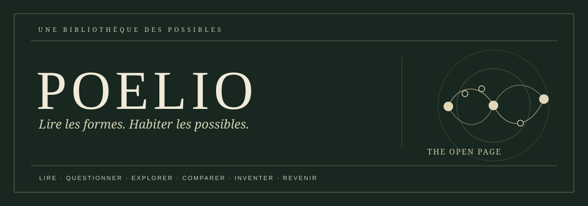

  

  <strong>Une littérature à éprouver, et non à résoudre.</strong> 
  <em>An open literary laboratory for reading, questioning, exploring, comparing, inventing, and reflecting.</em>

  
  &nbsp; <a href="LICENSE"><strong>MIT software</strong></a>
  &nbsp; · &nbsp; <a href="LICENSE-CONTENT.md">Literary rights</a>
  &nbsp; · &nbsp; <a href="docs/PRODUCT_SPEC.md">Product contract</a>
  &nbsp; · &nbsp; <a href="docs/RELEASE_NOTES_v0.2.0-rc.2.md">Research-preview notes</a>
  &nbsp; · &nbsp; <a href="docs/GITHUB_PAGES.md">GitHub Pages publishing</a>

---

## The page comes first

**POELIO** (*Plateforme Ouverte d’Exploration Littéraire et d’Interprétation des Œuvres*) is an independent, literature-first research project. It treats a work as something to be **read before being explained**, investigated without collapsing its meaning into a model, and answered through the reader's own writing.

The formal construction is an instrument of attention. It is never a substitute for the author or for literary judgment.

The long-term vision is an accessible, multilingual atelier connecting readers, writers, educators, digital-humanities researchers, and in-person workshops. The repository currently implements **two original public teaching works**, a reusable six-stage interface, and a separate finite-model explorer. This is a **research preview**, not a finished literary edition. GitHub Pages deployment requires independent activation and live verification; see [publishing status and limitations](docs/GITHUB_PAGES.md).

### Six movements through a work

|  | Stage | What the reader encounters |
|:--:|---|---|
| **01** | **Read · Lire** | The authored prose, uninterrupted by its mechanism. |
| **02** | **Question · Questionner** | An initial interpretation, before explanatory context. |
| **03** | **Explore · Explorer** | A finite, explicit compositional rule and its alternatives. |
| **04** | **Compare · Comparer** | Actual authored passages, never fabricated realizations. |
| **05** | **Invent · Inventer** | A new rule or an original text, composed by the reader. |
| **06** | **Reflect · Revenir** | A return to the first reading with new distinctions. |

There is no AI prose generation, literary-score oracle, account system, or server collection of participant writing.

## Two works, two ways of reading

| *Le Registre des clefs* | *Les Quatre Témoins* |
|---|---|
| An original short fiction structured around an eight-position relay. | Four original literary fragments viewed in different orders. |
| Its recurrence and perfect alternation rules conflict. | Exactly 24 permutations preserve every word of the four fragments. |
| Fourteen minimum-repair schedules are mathematically admissible. **Only two have authored realizations** in this demo. | Twelve of the 24 orders satisfy a stated precedence relation. **An order is not a new text authored by the program.** |

Both experiences preserve passage provenance and distinguish what a model establishes from what a reader interprets. The original French prose sits within a French/English interface. The unpublished *La Relève* manuscript and its private research materials **are not in this repository**.

## Enter the atelier

<strong>Literary experience · recommended starting point</strong>

Requires **Node.js 22.12+**, npm and a modern browser.

\`\`\`bash
git clone https://github.com/fraware/POELIO.git
cd POELIO/experience
npm ci
npm run build
npm run preview
\`\`\`

Open the **local address printed by Vite**. The first visit initializes the approved public-only offline shell in compatible browsers on localhost or HTTPS. No public POELIO website is deployed by these commands.

To run the development server, use \`npm run dev\`. To run unit and browser checks:

\`\`\`bash
npm run typecheck
npm test
npx playwright install chromium
npm run test:e2e
\`\`\`

<strong>Standalone finite-model explorer · technical companion</strong>

The earlier, deliberately separate mathematical explorer is retained at the repository root.

\`\`\`bash
cd POELIO
npm ci
npm test
npm run build:public
python3 -m http.server 8765 --bind 127.0.0.1 --directory dist
\`\`\`

Visit \`http://127.0.0.1:8765/\`. This is a finite-model explorer, **not** the literary six-stage interface.

### Read without the explanation

Two source-faithful first-reading routes support an unprimed encounter. Open them on your **local preview host**:

- \`/?review=register\` and \`/?review=permutation\` for the initial literary reading and optional private notes.
- \`/?companion=register\` and \`/?companion=permutation\` for complete, static explanatory companions.
- \`/facilitator.html\` for a printable **60-minute workshop guide**.

Keep the companion separate from the first reading until the initial response has been recorded. These are instruments for future editorial assessment, **not evidence that an independent study has taken place**.

## A small architecture with deliberate boundaries

\`\`\`text
       AUTHORED PUBLIC TEXT                    FORMAL MODEL
        (exact source pins)                 (finite, tested scope)
                │                                  │
                └───────────┬──────────────────────┘
                            │
                  APPROVED WORK CATALOG
               provenance + rights gate
                            │
              READ → QUESTION → EXPLORE
                → COMPARE → INVENT → REFLECT
                            │
                  BROWSER-LOCAL WRITING
               session-scoped / TXT export
                            │
                   PUBLIC-ONLY BUILD
                exact bytes + offline shell

      PRIVATE MANUSCRIPTS  ║  NO PUBLIC IMPORT ROUTE
\`\`\`

A model may enumerate possibilities; **it cannot establish literary merit, the meaning of a sentence, or the existence of a passage that was never written**.

The public build enforces an allowlist of five static files, source-identity checks, dependency audits, and exact-byte release evidence. Browser tests cover privacy, offline reading, keyboard focus, automated accessibility rules, and root/subpath hosting. Formal Lean research evidence is separate from these executable checks.

## The documentation library

| Start here | Purpose |
|---|---|
| [Literary product contract](docs/PRODUCT_SPEC.md) | The North Star and non-negotiable six-stage encounter |
| [Editorial visual system](docs/ART_DIRECTION.md) | Typographic direction, responsive design and acceptance boundaries |
| [Architecture](docs/ARCHITECTURE.md) | Public/private boundaries and finite-model responsibilities |
| [Content and provenance](docs/PUBLIC_CONTENT_CONTRACT.md) | Why only authored, approved source enters the reader |
| [Editorial quality](docs/EDITORIAL_QUALITY_GATE.md) | What counts as literary critique, not mechanical validation |
| [Independent reading protocol](docs/EDITORIAL_REVIEW_PROTOCOL.md) | Unprimed reading and later discussion |
| [Workshop protocol](docs/WORKSHOP_PILOT.md) | A future physical-session plan |
| [Accessibility acceptance](docs/ACCESSIBILITY_ACCEPTANCE.md) | Tested behaviors and outstanding human checks |
| [Security and privacy](docs/SECURITY_PRIVACY_ACCEPTANCE.md) | Local drafts, network behavior and residual risks |
| [Releases and private preflight](docs/RELEASE_AND_CANDIDATE_PREFLIGHT.md) | Exact-byte builds and quarantined candidate sources |
| [Complete documentation map](docs/INDEX.md) | All specifications, protocols and engineering evidence |

## Reader privacy and authorial integrity

POELIO does not submit a participant's writing to an application server. The public creative stages use **per-tab browser session storage** with an in-memory fallback; editorial first-reading notes stay in memory only. Readers explicitly export their work as a local text file. A shared-device control clears this tab's draft fields for both public works.

**Browser session storage is not encrypted**, and its retention depends on browser lifecycle and session restoration. A static hosting provider still receives ordinary HTTP access metadata. The code has no user analytics, cloud poem storage or AI inference endpoint.

No private manuscript, unreleased research archive, blind-study source, or participant record belongs in this repository or its build output. Removing such data in a later commit does not undo exposure through Git history.

## License and attribution

**Software: [MIT](LICENSE). Literary texts: [separate permissions](LICENSE-CONTENT.md).**

The MIT license covers the reusable software, tests, tooling and software documentation. The public teaching prose has distinct literary rights, with limited permission to reproduce it unaltered as part of the noncommercial research/teaching demonstration. **MIT does not license unpublished *La Relève*** or grant general republication rights to any manuscript.

To contribute, read [CONTRIBUTING.md](CONTRIBUTING.md); for a private vulnerability disclosure, read [SECURITY.md](SECURITY.md). Researchers may use [CITATION.cff](CITATION.cff), identifying the commit actually used.

## Present status

**Research preview · [versioned research releases](https://github.com/fraware/POELIO/releases).** The local public teaching demo and automated verification pipeline are operational. The prerelease is a source snapshot, not a publicly hosted POELIO website or a finished literary edition. Consult the [Releases page](https://github.com/fraware/POELIO/releases) for the verified version and date.

Still outstanding: independent literary editorial evaluation, manual screen-reader/WCAG acceptance, original-work publication decisions, actual hosted HTTP-header verification, and properly designed empirical workshop evaluation. A green CI run does not confer these outcomes.

*POELIO is independent. No affiliation with, sponsorship by, or endorsement from Oulipo is claimed.*
